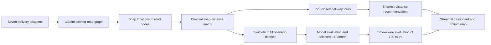

# Smart Route Optimizer

### An Intelligent Delivery Route Optimization and ETA Prediction System Using Road Networks and Machine Learning

## Project overview

Inefficient delivery order and distance can increase travel time and operating
costs. This project compares two ways to plan a delivery run: minimize the
total road-network distance, or minimize the cumulative delivery time
predicted for the selected vehicle and departure conditions.

The prototype combines OpenStreetMap (OSM) driving roads, NetworkX Dijkstra
shortest paths, exhaustive delivery-sequence search, a machine-learning ETA
model, and an interactive Streamlit dashboard. It covers one warehouse and
six customer locations in Mwihoko, Githurai, and nearby Kahawa, Kenya.

## Project objectives

- Find efficient delivery sequences across the six fixed customer locations.
- Minimize the total directed road-network distance from and back to the
  warehouse.
- Minimize the predicted cumulative travel time, updating the departure hour
  as the vehicle completes each leg.
- Compare recommendations for motorcycles, cars, and vans across departure
  hours and days of the week.
- Show the recommended sequence and its road paths on an interactive map.

## Study area and delivery locations

| ID | Location |
|---|---|
| W | Mwihoko Shopping Centre — warehouse |
| A | Mwihoko 46 Shopping Centre |
| B | Savory Supermarket |
| C | Stanmatt Supermarket Githurai 45 |
| D | Naivas Githurai 44 |
| E | Cleanshelf Kahawa Wendani |
| F | Quickmart Kahawa Sukari |

The Naivas coordinate supplied to the study is approximately **110.2 m**
from its nearest routable graph node. The nearest mapped road segment is
Kamiti Road at about 78.0 m from the supplied point, but the actual delivery
entrance has not been verified. The coordinate is retained and the location
is flagged for field verification. A diagnostic map is available at
[`visualizations/naivas_snap_diagnostic.html`](visualizations/naivas_snap_diagnostic.html).

## System architecture



The source location file is kept separately from the snapped-location output.
The six-customer road graph and data products use `_6_customers` filenames;
the original three-customer prototype files remain in the repository.

## Route optimization methodology

### Shortest distance

For each directed origin–destination leg, NetworkX Dijkstra finds a path
weighted by OSM road-edge length. The route optimizer enumerates every
permutation of the six customers, sums the seven directed legs, and selects
the route with the least total distance. Every tour starts at W and returns
to W.

### Fastest delivery time

For each of the same customer sequences, the system predicts each leg's
duration from the selected vehicle, departure hour, weekday, route distance,
road-edge count, and free-flow estimate. Each predicted leg advances the
clock before the following leg's departure hour is calculated. The sequence
with the lowest cumulative predicted duration is selected, and its total
road distance is reported.

Six customers produce `6! = 720` possible delivery sequences. Distance and
time are separate objectives. On each dashboard submission, both are
calculated using the same configuration. The selected objective determines
the primary recommendation and map route; both results remain visible in the
comparison section. If both methods choose the same sequence, the dashboard
identifies that result explicitly.

The time objective ranks delivery sequences using ETA predictions, while
each individual leg is still drawn along its shortest-distance road path.
The system does not search for a different time-weighted road path for each
leg.

## ETA prediction methodology

The generated dataset has 105,840 simulated rows:

`42 directional legs × 7 weekdays × 24 departure hours × 5 repetitions × 3 vehicle types`

The predictive features are:

- `origin_zone`
- `destination_zone`
- `route_distance_km`
- `road_edge_count`
- `departure_hour`
- `day_of_week`
- `vehicle_type`
- `estimated_free_flow_min`

The target is `delivery_duration_min`. `replicate_id` identifies the five
simulated repetitions and is excluded from model features. The simulation
uses assumed speeds (motorcycle 30 km/h, car 25 km/h, van 22 km/h),
hour-of-day and weekday multipliers, an assumed 0.04-minute delay per road
edge, and seeded random noise. These are illustrative generation assumptions,
not observed local travel or traffic measurements.

The workflow compares a median baseline, Linear Regression, Random Forest,
and Gradient Boosting. It reports mean absolute error (MAE), root mean
squared error (RMSE), and R² on a scenario-based train/test split, a held-out
directional-route test, and four-fold GroupKFold evaluation by directional
route. The scenario split keeps repetitions from one simulation scenario in
the same partition. The unseen-route and grouped evaluations check
generalization to route pairs excluded from training.

### Saved evaluation results

The current saved run selected **Linear Regression** using mean rank across
unseen-route holdout MAE and route-grouped cross-validation fold MAE. Model
selection does not use R² alone.

| Evaluation | Model | MAE (min) | RMSE (min) | R² |
|---|---|---:|---:|---:|
| Scenario test split | Linear Regression | 1.195 | 1.591 | 0.962 |
| Scenario test split | Random Forest | 1.175 | 1.604 | 0.961 |
| Unseen directional routes | Linear Regression | 1.280 | 1.780 | 0.955 |
| Unseen directional routes | Random Forest | 1.410 | 1.863 | 0.950 |
| Four-fold route CV (pooled) | Linear Regression | 1.216 | 1.626 | 0.961 |
| Four-fold route CV (pooled) | Random Forest | 1.234 | 1.696 | 0.957 |

For route-grouped CV, Linear Regression's mean fold MAE was 1.221 minutes
(standard deviation 0.121); Random Forest's was 1.240 minutes (standard
deviation 0.174). Linear Regression ranked first on both route-generalization
MAE checks, although Random Forest had slightly lower MAE on the scenario
test split. Full saved comparisons are in `data/processed/`.

**These metrics measure fit to simulated labels. They do not demonstrate
real-world ETA or traffic prediction accuracy.**

## Dashboard features

- Vehicle, day of week, departure time, and optimization objective controls.
- Primary route, total distance, predicted time, and customer stop count.
- Side-by-side shortest-distance and fastest-time results, with the selected
  objective highlighted.
- Interactive map with all seven places, numbered delivery stops, directional
  arrows, and routes drawn along the road graph.
- Leg-by-leg road distance, predicted ETA, and departure-hour breakdown,
  including the return to the warehouse.
- Session-state results that remain visible after map interactions and
  Streamlit reruns.
- Route Intelligence Assistant with Python-grounded route comparisons,
  delivery bottlenecks, recommendations, limitations, and isolated what-if
  vehicle/departure scenarios.
- Optional OpenAI-compatible conversational explanations; deterministic Python
  analysis remains available without an API key.
- Model and data transparency notes in the application.

### Route Intelligence Assistant configuration

The assistant's Python analysis mode works without extra packages, credentials,
or external services. It answers from the current optimization results held in
the Streamlit session. What-if questions re-run the existing distance and ETA
optimizers for the requested vehicle, departure hour, and weekday. Scenario
results stay separate from the current dashboard until **Apply scenario to
dashboard** is selected.

For optional conversational explanations, configure an API key and (optionally)
an OpenAI-compatible provider endpoint and model. In local development, set
environment variables:

```powershell
$env:ROUTE_ASSISTANT_API_KEY = "your-provider-key"
$env:ROUTE_ASSISTANT_API_BASE = "https://api.openai.com/v1"
$env:ROUTE_ASSISTANT_MODEL = "gpt-4o-mini"
```

On Streamlit Cloud, add these values under **App settings → Secrets**:

```toml
route_assistant_api_key = "your-provider-key"
route_assistant_api_base = "https://api.openai.com/v1"
route_assistant_model = "gpt-4o-mini"
```

Only the API key is required; the endpoint and model have OpenAI-compatible
defaults. For another compatible provider, set its API base URL and model.
The provider receives the user's question and the current route context plus
the approved Python analysis. If configuration is missing or the provider
request fails, the app uses Python analysis instead. Credentials are read from
Streamlit secrets or environment variables and must never be committed to the
repository. No LLM package is required.

## Technologies

- Python
- Pandas and NumPy
- Scikit-learn and Joblib
- NetworkX and OSMnx
- OpenStreetMap road data
- GeoPandas, PyProj, and Shapely for location diagnostics
- Folium and Streamlit-Folium
- Streamlit
- Matplotlib for exploratory analysis figures

## Installation and setup (Windows)

Git LFS is used for `.joblib` model artifacts, including an older prototype
model. Install [Git LFS](https://git-lfs.com/) before cloning so those model
files are downloaded correctly.

```powershell
git lfs install
git clone https://github.com/Gi-ft/Smart-Route-Optimizer.git
cd Smart-Route-Optimizer
python -m venv .venv
.\.venv\Scripts\Activate.ps1
python -m pip install -r requirements.txt
```

Launch the dashboard from the project root:

```powershell
python -m streamlit run app.py
```

The committed expanded graph, snapped locations, distance matrices, and
trained model let the dashboard run without rebuilding the study data.
To regenerate the network and model, run the scripts from the project root
in this order (network extraction requires internet access to OSM Overpass):

```powershell
python src/location_mapping.py
python src/road_network.py
python src/distance_matrix.py
python src/generate_eta_dataset.py
python src/eta_modelling.py
python src/route_optimizer.py
python src/time_route_optimizer.py
python src/run_scenario_analysis.py
```

Run the available end-to-end checks with:

```powershell
python src/evaluation.py
```

To recreate the Naivas snap diagnostic without changing its coordinate or
the route inputs:

```powershell
python src/diagnose_naivas_snap.py
```

## Repository layout

```text
app.py                         Streamlit dashboard
.streamlit/config.toml         Light navy/teal application theme
src/                           Routing, ETA, network, and validation modules
data/raw/                      Original and six-customer inputs and graph assets
data/processed/                Distance, route, and model evaluation outputs
models/                        Trained model artifacts (Git LFS)
visualizations/                EDA figures and Naivas diagnostic map
README.md                      Project documentation
STUDY.md                       Research framing and methodology notes
requirements.txt               Python dependencies
```

## Limitations

- ETA durations and traffic factors are simulated; there are no observed
  delivery trips or live traffic measurements in the model.
- The fixed study network contains one warehouse and six customers.
- Route quality depends on the available OpenStreetMap road coverage and the
  supplied location coordinates. Naivas's delivery entrance still needs
  field verification.
- The time objective ranks tours by predicted duration but uses
  shortest-distance road paths for individual legs.
- Vehicle capacity, service time at stops, delivery time windows, road
  closures, multiple vehicles, and real-time dynamic rerouting are not
  currently modeled.

## Future improvements

- Collect observed delivery durations and validate predictions on real trips.
- Integrate a live traffic source where coverage and licensing allow.
- Expand the study to more delivery zones.
- Add vehicle capacities, multiple vehicles, depot scheduling, and delivery
  time windows.
- Support dynamic rerouting for disruptions and updated road conditions.

## Author and project information

Repository maintainer: [Gi-ft](https://github.com/Gi-ft). Prepared as a
university final-year project and portfolio prototype. No institutional,
supervisor, or award details are listed because they were not provided.

The repository has no license file; no reuse or redistribution license has
been selected.
